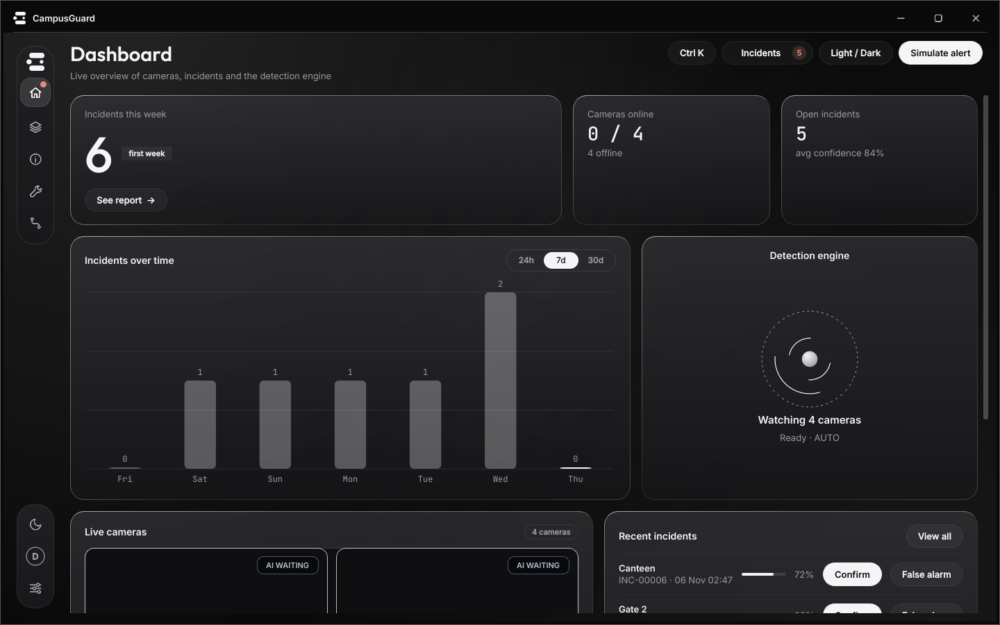

# CampusGuard

**Your school's cameras, watching for fights so nobody has to.**

*Demo data on a machine with no cameras attached.*

## The problem

A school may have 40 to 60 CCTV cameras and one person who might glance at the screens between other jobs. Fights are over in seconds. By the time anyone notices, the moment has passed, staff arrive late, and afterwards nobody can say what happened or who was involved. Manual monitoring either misses incidents or drowns people in false alarms until they stop looking.

## What CampusGuard does

CampusGuard turns the cameras a school already owns into an always-on safety layer. It runs on an ordinary Windows PC, needs no new hardware, and works quietly in the background.

- **Notices a fight as it starts.** It watches every camera and scores how likely it is that people are really fighting, so normal sport and horseplay don't set it off.
- **Tells the right person straight away.** Alerts are graded by seriousness and go to the head of the school's phone (WhatsApp or push), with the camera, the time and how sure it is. Serious ones sound an alarm on the office PC.
- **Keeps the evidence.** Every incident saves a short clip and a timeline. Administrators review what happened calmly and fairly afterwards, instead of relying on memory or on the AI to blame anyone.
- **Scales to a whole school.** One office PC can run dozens of cameras, with a floor map to see where things are happening and health notices when a camera goes dark.
- **Stays private.** Video is analysed and stored on the school's own PC. No facial recognition, no identity matching, and footage is never uploaded.

## How it fits together

| Piece | Who uses it | What it is for |
|---|---|---|
| **Desktop app** (this repo) | School office / IT | Connects cameras, detects fights, saves clips, sends alerts |
| **Phone app** (Android) | Head of school, staff | Live status of cameras and alerts, and a push when something happens |
| **Website** ([campusguardweb](https://github.com/hisir-sys/campusguardweb)) | Everyone | Early-access sign-up, account details, and a summary of cameras and incidents (never video) |

One account works across all three, including your name, school and the phone numbers that receive alerts.

## Why it is built this way

- **Two checks, not one.** A quick motion check keeps the heavy AI idle while a scene is calm, and the fight model only judges what people are doing when something is moving. That is what lets a modest PC cover many cameras.
- **Graded alerts instead of one alarm.** A possible fight and a certain fight deserve different responses, so staff aren't trained to ignore the alert.
- **Existing cameras only.** USB, RTSP, HTTP/MJPEG and IP cameras that OpenCV can open. No replacement of the school's CCTV.
- **Honest about missing parts.** If a model file is missing, CampusGuard says so. It never pretends to detect.

## Status

Built and tested with simulated cameras. It has not yet run on a real school's camera network, and real WhatsApp delivery and large-scale camera load still need to be checked on the school's own hardware. The first target is a school in Kolkata.

## Get it

Early access is by approval. Request an account on the website, then download the installer from your account.

Questions or a pilot: WhatsApp +91 70032 76998.

## More

- [School server guide](docs/SERVER.md): running one server for a whole school, alerts, API
- [School deployment](docs/SCHOOL_DEPLOYMENT.md) and [load test guide](docs/LOAD_TEST_GUIDE.md)
- [Developer guide](docs/DEVELOPMENT.md): running from source, cameras, models, troubleshooting
- [Change log](CHANGELOG.md) and [more screenshots](docs/screenshots)

## Licence

Copyright (c) 2026 CampusGuard. All rights reserved. This is proprietary software, not open source. Seeing it here does not give anyone the right to use, copy or share it. See [LICENSE](LICENSE) and [third-party notices](THIRD_PARTY_NOTICES.md).
